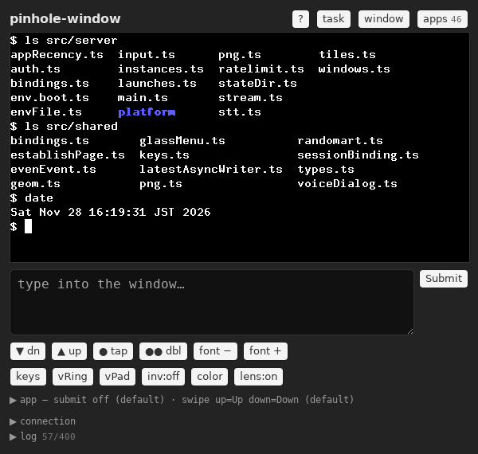
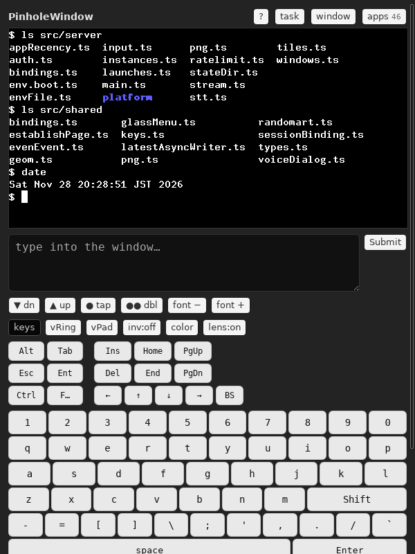
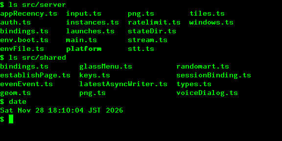
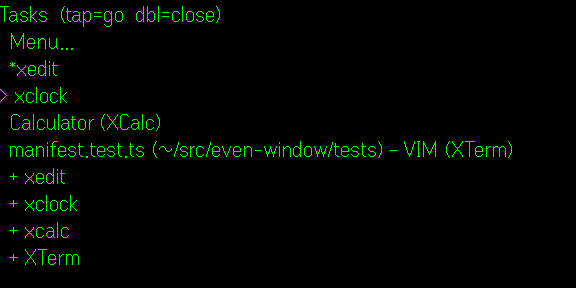
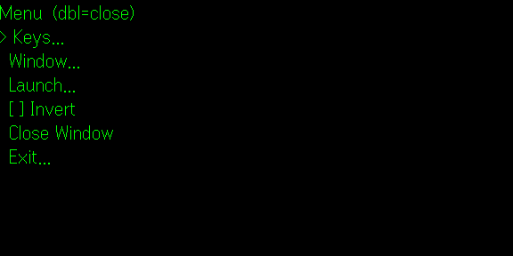
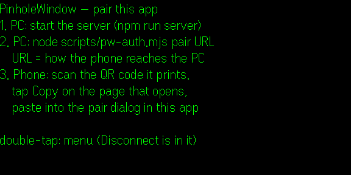
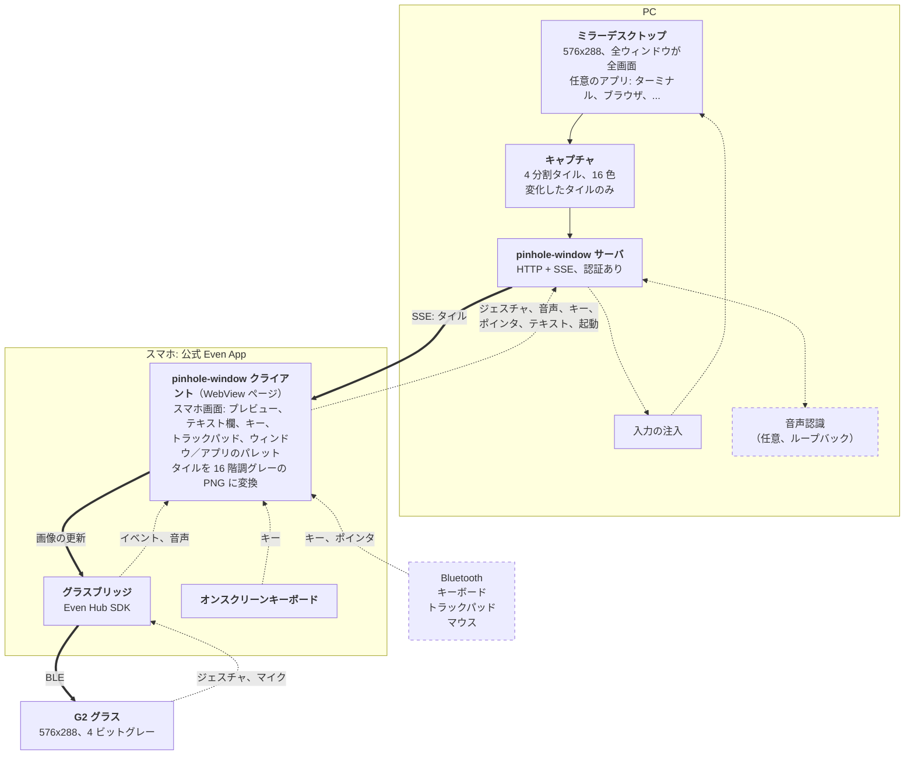

# PinholeWindow

_あなたのデスクトップを、ピンホール越しに。_

[English](README.md) | 日本語

描くのは PC、映すのはグラス。PinholeWindow（リポジトリ名は `pinhole-window`）は、PC 上のデスクトップセッションを Even Realities G2 スマートグラスに
ミラーし、グラスとスマホから操作できるようにします。Even Hub アプリ（公式 Even App の
中で動く WebView ページ）と、PC 上の小さなサーバで構成されています。

サーバは専用の 576×288 のミラーデスクトップを動かし、それをキャプチャしてグラスへ
配信します。テンプルやリングのジェスチャがキーを送り返し、グラス上のメニューで
ウィンドウの切り替えとアプリケーションの起動ができ、音声は自分の PC 上で認識して
フォーカス中のウィンドウに入力できます。

## スクリーンショット

Even Hub シミュレータで、ミラーデスクトップにターミナルを表示して撮影したものです。

| スマホ画面 | `keys` を開いたスマホ画面 | グラス上の表示 |
| --- | --- | --- |
|  |  |  |

| タスク一覧：ウィンドウの切り替えとアプリの起動 | メニュー | 初回起動時のペアリング手順 |
| --- | --- | --- |
|  |  |  |

スマホ画面には、ミラー中のウィンドウのライブプレビュー、そのウィンドウに文字を入力する
テキストボックス、グラスのジェスチャを送るボタン、各種ツールが並びます。ツールは、修飾キー
付きのオンスクリーンキーボード（`keys`）、仮想リングとトラックパッド（`vRing`、`vPad`）、
タスク・ウィンドウ操作・アプリ起動のパレットです。詳しくは [docs/phone-ui.md](docs/phone-ui.md)
を参照してください。

## 仕組み



太い矢印は映像を、点線の矢印は入力を運びます。ウィンドウ管理と描画は PC が担い、
グラスはタイルを表示してジェスチャを報告するだけです。クライアントのページは
スマホ画面とグラス側の両方を動かし、グラスには Even App のブリッジ経由でのみ届きます。

## できること・できないこと

できること:

- ミラーデスクトップのウィンドウをグラスにミラーする（変化した部分だけを送る）
- グラスのジェスチャからキーを送る（スワイプの割り当てはアプリケーションごとに設定可能）
- グラスまたはスマホからアプリケーションを切り替え・終了・起動する
- 音声で入力する（認識は自分の PC 上のサービスが行う）
- スマホにキーボード、トラックパッド、タッチ可能なミラーのプレビューを提供する
- スマホとペアリングした Bluetooth のキーボード、マウス、トラックパッドを使う
  （[iPhone での設定](docs/usage.ja.md#スマホ画面)）

できないこと:

- カラー表示（グラスは 4 ビットグレー）や滑らかな動画（タイルの更新 1 回におよそ
  75 ms と転送時間がかかる）
- 既存のデスクトップのミラー。対象はミラーデスクトップの中で起動したアプリケーションだけ
- Windows での動作（現時点）。サーバは 1 つのインターフェース
  （[docs/platform.md](docs/platform.md)）を通して OS に触れており、バックエンドは X11 の
  デスクトップを動かすものだけ。開発と検証は Linux で行っており、X11 のあるほかの Unix 系は未検証
- グラスでの 1 日を通した作業。連続使用すると G2 のバッテリは数時間で切れるため、外出時や
  家事中に PC の状況を一時的に確認するような用途に向いている。このため、グラスがなくても
  ひととおりの機能はスマホだけで実行できるようにしてある

## 必要なもの

- Linux（WSL2 + WSLg でも動作）と Node.js 22.18 以降
- `sudo apt install -y xvfb ratpoison ffmpeg xdotool x11-utils xterm`
  （任意: `xserver-xephyr`。ミラーデスクトップを PC のウィンドウでも見る場合）
- Even Realities G2 グラスと、開発中のアプリを読み込める Even App
- スマホからサーバへ届くための TLS フロントエンド（`tailscale serve` など）
- 任意: 音声入力のための OpenAI 互換の音声認識サービス

## クイックスタート

```bash
npm ci
npm run server      # API は 127.0.0.1:8787。ミラーデスクトップを起動する
npm run dev         # クライアントのページをポート 5273 で配信（別のターミナルで）
```

認証は既定で有効なので、接続する前に端末をペアリングします。同じマシンのブラウザで
試す場合:

```bash
node scripts/pw-auth.mjs pair 'http://127.0.0.1:5273/?server=http://127.0.0.1:8787'
```

表示された URL を開き、**Pair this app** をタップし、両方の画面に出るパターンを
見比べて `y` と答えます。実機のスマホとグラスで使うには、サーバを `tailscale serve`
の後ろに置き、Even App でアプリを読み込みます:
[docs/getting-started.ja.md](docs/getting-started.ja.md)。

認証済みのルートはすべて、あなたのユーザ権限でのリモートコード実行に相当します。
認証は有効のまま、サーバはループバックのままにしてください。[SECURITY.md](SECURITY.md)
を参照してください。

## ドキュメント

利用者向け（それぞれ英語版があります）:

| ドキュメント | 内容 |
| --- | --- |
| [はじめに](docs/getting-started.ja.md) | インストール、起動、ペアリング、スマホの接続、サービスとして動かす |
| [使い方](docs/usage.ja.md) | ジェスチャ、グラスのメニュー、スマホ画面、音声入力 |
| [設定](docs/configuration.ja.md) | 環境変数、env ファイル、状態ファイル。[ランチャにアプリを追加する](docs/configuration.ja.md#appsconf)、[起動時に開くものを選ぶ](docs/configuration.ja.md#ミラーデスクトップlinux-バックエンド)（`PINHOLE_SPAWN`） |
| [Firefox](docs/firefox.ja.md) | ミラーデスクトップで Firefox を動かす |
| [トラブルシューティング](docs/troubleshooting.ja.md) | 症状・原因・対処 |
| [ステータス](docs/status.ja.md) | 実機で確認済みの範囲と既知の制限 |

内部リファレンス（英語のみ）:

| ドキュメント | 内容 |
| --- | --- |
| [Architecture](docs/architecture.md) | 概要、パイプライン、画面とタイルの幾何 |
| [Protocol](docs/protocol.md) | クライアントとサーバの間の HTTP / SSE の契約 |
| [Glasses](docs/glasses.md) | コンテナ、タイルのパイプライン、ジェスチャ、グラス上のメニュー |
| [Phone UI](docs/phone-ui.md) | スマホ側の操作面 |
| [Security](docs/security.md) | 認証、ペアリング、セッション、脅威モデル、トランスポート |
| [Voice](docs/voice.md) | 音声入力 |
| [Platform](docs/platform.md) | OS との境界、X11 バックエンド、バックエンドの追加 |
| [Development](docs/development.md) | 開発ループ、シミュレータのハーネス、検証手順 |

背景資料: [docs/decisions/](docs/decisions/) に短い設計判断の記録、
[docs/notes/](docs/notes/) に日付つきの計測・調査ログがあります。全体の索引は [docs/README.md](docs/README.md) です。

## ステータス

概念実証（PoC）です。ミラー、ジェスチャ、ウィンドウ切り替え、音声入力は実機の G2 で
動作します。ほかのいくつかの機能は Even Hub シミュレータでのみ確認しています。
機能ごとの検証状況と既知の制限: [docs/status.ja.md](docs/status.ja.md)。

## コントリビュート

[CONTRIBUTING.md](CONTRIBUTING.md) を参照してください。引用している第三者プロジェクトと
商標については [NOTICE.md](NOTICE.md) を参照してください。

## ライセンス

MIT。[LICENSE](LICENSE) を参照してください。
