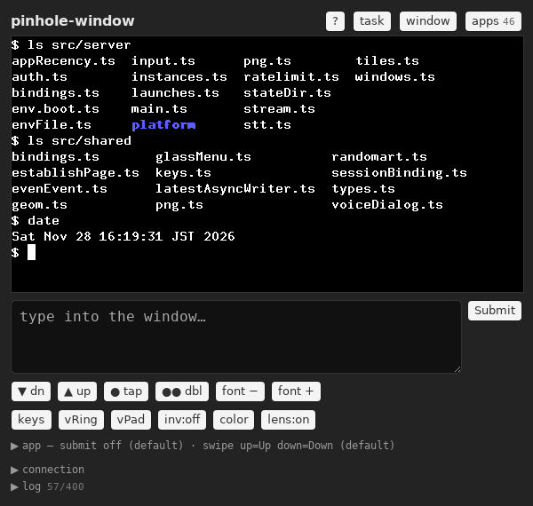
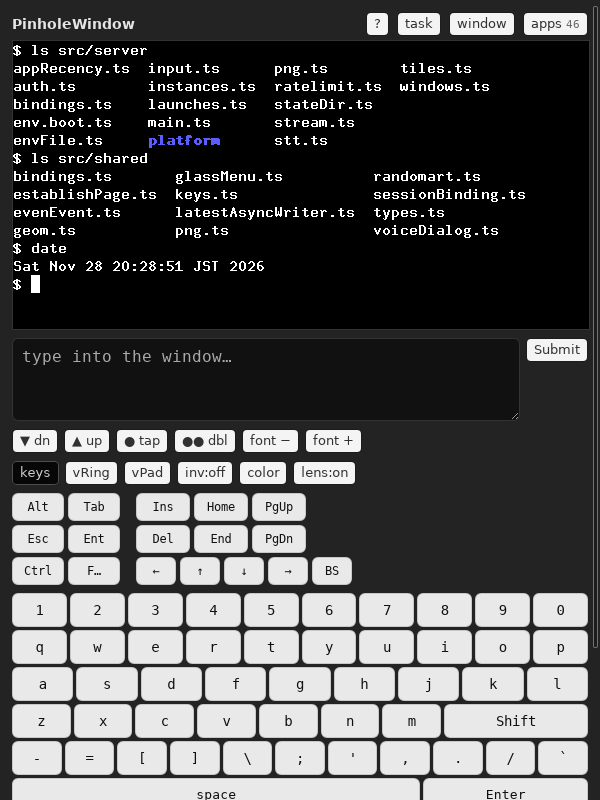
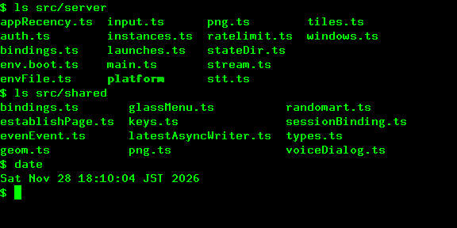
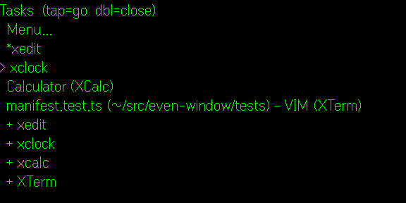
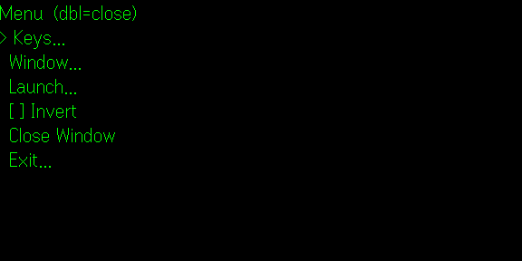
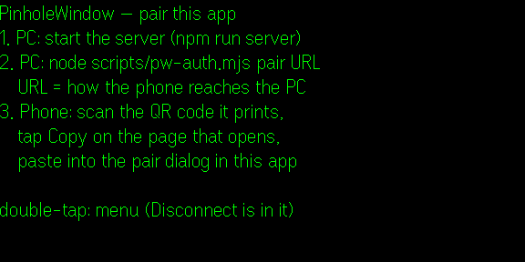
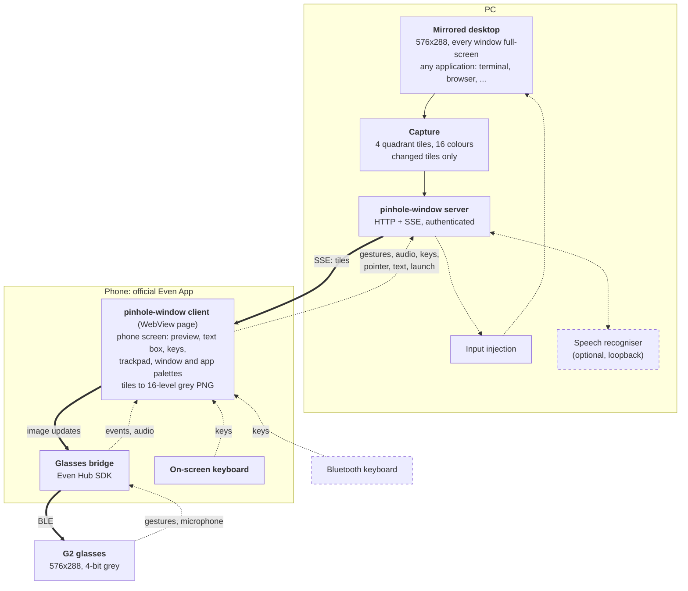

# PinholeWindow

English | [日本語](README.ja.md)

PinholeWindow (repository `pinhole-window`) mirrors a desktop session on your PC to Even Realities G2 smart glasses
and lets you operate it from the glasses and from your phone. It is an Even Hub app
(a WebView page inside the official Even App) plus a small server on the PC.

The server runs a dedicated 576×288 mirrored desktop, captures it, and streams it to
the glasses. Temple and ring gestures send keys back, a menu on the glasses switches
windows and launches applications, and speech can be transcribed on your own PC and
typed into the focused window.

## Screenshots

Taken in the Even Hub simulator with a terminal on the mirrored desktop.

| Phone screen | Phone screen with `keys` open | On the glasses |
| --- | --- | --- |
|  |  |  |

| Tasks: switch windows, launch apps | The menu | Pairing steps on first start |
| --- | --- | --- |
|  |  |  |

The phone screen shows a live preview of the mirrored window, a text box that types into it,
buttons for the glasses gestures, and tools: an on-screen keyboard with modifiers (`keys`),
a virtual ring and trackpad (`vRing`, `vPad`), and palettes for tasks, window actions and
launching applications. Details: [docs/phone-ui.md](docs/phone-ui.md).

## How it works



Thick arrows carry the picture; dotted arrows carry input back. The PC owns window
management and rendering; the glasses only display tiles and report gestures. The
client page runs both the phone screen and the glasses side, and reaches the glasses
only through the Even App's bridge.

## What it can and cannot do

It can:

- mirror the windows of the mirrored desktop to the glasses, sending only what changed;
- send keys from glasses gestures, with per-application swipe bindings;
- switch, close and launch applications from the glasses or the phone;
- type by voice, recognised by a service on your own PC;
- give the phone a keyboard, a trackpad and a touchable preview of the mirror;
- take a Bluetooth keyboard, mouse or trackpad paired with the phone
  ([setup on iPhone](docs/usage.md#the-phone-screen)).

It cannot:

- show colour (the glasses are 4-bit grey) or smooth video (each tile update costs
  roughly 75 ms plus transfer time);
- mirror your existing desktop — only applications started inside the mirrored desktop;
- run on Windows yet. The server reaches the operating system through one interface
  ([docs/platform.md](docs/platform.md)), and the only backend drives an X11 desktop. It is
  developed and tested on Linux; other Unix systems with X11 are untested.
- last a working day on the glasses. Continuous use drains the G2 battery in a few hours,
  so it suits short check-ins on your PC while you are out or doing chores rather than
  all-day work. For the same reason, everything can also be done from the phone alone,
  without the glasses.

## Requirements

- Linux (WSL2 with WSLg works) and Node.js 22.18 or newer
- `sudo apt install -y xserver-xephyr xvfb ratpoison ffmpeg xdotool x11-utils xterm`
- Even Realities G2 glasses and the Even App, able to load a development app
- A TLS front end such as `tailscale serve` to reach the server from a phone
- Optional: an OpenAI-compatible speech-to-text service for voice input

## Quick start

```bash
npm ci
npm run server      # API on 127.0.0.1:8787; starts the mirrored desktop
npm run dev         # the client page on port 5273 (second terminal)
```

Authentication is on by default, so pair a device before it can connect. To try it
in a browser on the same machine:

```bash
node scripts/pw-auth.mjs pair 'http://127.0.0.1:5273/?server=http://127.0.0.1:8787'
```

Open the printed URL, tap **Pair this app**, compare the pattern shown on both
screens, and answer `y`. To use a real phone and the glasses, put the server behind
`tailscale serve` and load the app in the Even App:
[docs/getting-started.md](docs/getting-started.md).

Every authenticated route amounts to remote code execution as your user. Keep
authentication on and the server on loopback; see [SECURITY.md](SECURITY.md).

## Documentation

For users (each has a Japanese translation):

| Document | Contents |
| --- | --- |
| [Getting started](docs/getting-started.md) | Install, run, pair, connect a phone, run as a service |
| [Usage](docs/usage.md) | Gestures, the glasses menu, the phone screen, voice input |
| [Configuration](docs/configuration.md) | Environment variables, the env file, state files |
| [Firefox](docs/firefox.md) | Running Firefox on the mirrored desktop |
| [Troubleshooting](docs/troubleshooting.md) | Symptoms, causes and fixes |
| [Status](docs/status.md) | What is verified on hardware, and known limitations |

Internal reference (English):

| Document | Contents |
| --- | --- |
| [Architecture](docs/architecture.md) | Overview, pipeline, screen and tile geometry |
| [Protocol](docs/protocol.md) | The HTTP and SSE contract between client and server |
| [Glasses](docs/glasses.md) | Containers, tile pipeline, gestures, the on-glasses menu |
| [Phone UI](docs/phone-ui.md) | The phone-side operating surface |
| [Security](docs/security.md) | Authentication, pairing, sessions, threat model, transport |
| [Voice](docs/voice.md) | Voice input |
| [Platform](docs/platform.md) | The OS seam, the X11 backend, adding a backend |
| [Development](docs/development.md) | Dev loop, simulator harness, verification recipes |

Background: [docs/decisions/](docs/decisions/) holds short design decision records,
and [docs/notes/](docs/notes/) holds dated measurement and investigation logs. The full index is [docs/README.md](docs/README.md).

## Status

A proof of concept. Mirroring, gestures, window switching and voice input work on a
real G2; several other features are verified only in the Even Hub simulator.
Per-feature verification and known limitations: [docs/status.md](docs/status.md).

## Contributing

See [CONTRIBUTING.md](CONTRIBUTING.md). Third-party citations and trademarks:
[NOTICE.md](NOTICE.md).

## Licence

MIT. See [LICENSE](LICENSE).
