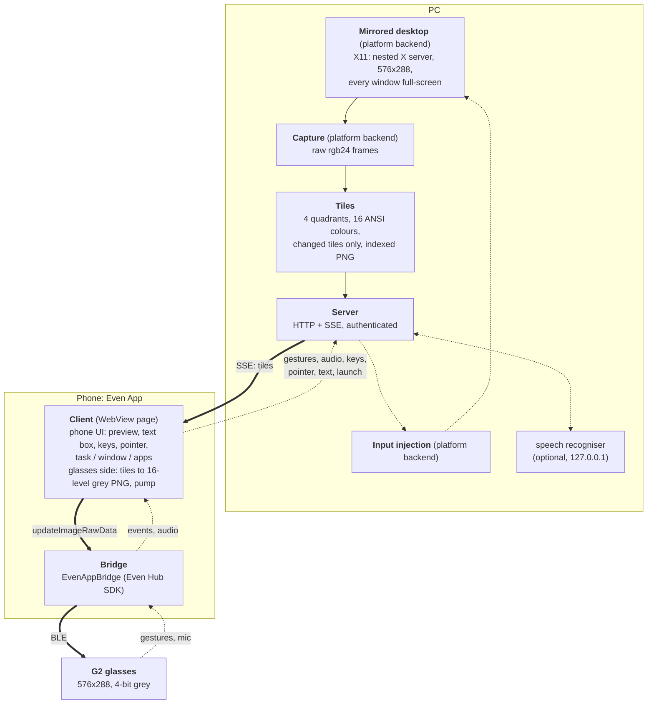

# Architecture

pinhole-window mirrors a small desktop on a PC to Even Realities G2 glasses and lets the wearer
drive it. A server on the PC keeps a 576x288 mirrored desktop alive, captures it, and streams
the parts that changed. A WebView page inside the Even App on the phone turns those into
glasses images and sends gestures, keys, pointer events and speech back.

## Scope

The system does four things: it mirrors the desktop, offers light control from the glasses,
switches windows, and launches applications. Two things that look like more are not:

- Voice input is one more way to type. A transcript is injected with the same `type`
  input as the phone's text box ([voice.md](voice.md)).
- The phone UI is an operating surface for the same four things
  ([phone-ui.md](phone-ui.md)). Its `task`, `window` and `apps` panels work without glasses.

## Pipeline

The diagram shows the X11 backend, the only one that exists. Thick arrows carry the picture;
dotted arrows carry input back.

Stage by stage:

1. **Mirrored desktop.** The backend keeps a desktop of exactly the panel size alive. It
   outlives the server process, so a server restart does not close the user's applications
   ([platform.md](platform.md#display-session-lifecycle)).
2. **Capture.** The backend delivers whole frames: 576x288, rgb24, rows top to bottom
   (`FRAME_BYTES` = 497,664 bytes).
3. **Tiles** (`src/server/tiles.ts`). A frame identical to the previous one is dropped with one
   comparison. Otherwise each quadrant whose raw pixels changed is quantised to 16 ANSI colours
   and, if the quantised tile differs from the last one sent, encoded as an indexed PNG. A
   static screen emits nothing; a blinking cursor emits one tile.
4. **Stream** (`src/server/stream.ts`). Tiles go out as SSE events. The hub retains the latest
   tile per quadrant and the latest state events, so a new subscriber is brought up to date at
   once ([protocol.md](protocol.md#priming-on-subscribe)).
5. **Client.** The page decodes each tile to an index plane and keeps only the newest one per
   quadrant. When a tile is about to be sent it is converted to 16-level grey and re-encoded
   (`encodeTilePng` in `src/shared/png.ts`), then pushed with `updateImageRawData`. The PNG the
   server sends and the PNG the glasses receive are different images
   ([glasses.md](glasses.md)).
6. **Input.** Gestures are normalised and debounced on the client, then posted to the server,
   which resolves them to a key chord or wheel turn and hands it to the backend. Keys, text,
   pointer and launch requests from the phone UI take the same road
   ([protocol.md](protocol.md#routes)).

The PC owns window management and rendering. The glasses display pixels and report gestures.
There is no step that fits a window to the viewport: the backend's desktop shows one window at
a time, full-screen.

What the pipeline cannot do: colour (the panel is 4-bit grey), smooth video (each tile push
over BLE has a fixed cost, see [glasses.md](glasses.md)), or anything outside the mirrored
desktop.

## Screen and tile geometry

`src/shared/geom.ts` is the single source for both sides.

| Constant | Value | Meaning |
| --- | --- | --- |
| `SCREEN_W` x `SCREEN_H` | 576 x 288 | The glasses panel and the mirrored desktop |
| `TILE_W` x `TILE_H` | 288 x 144 | One image container |
| `TILES` | 4 | Tile index order: top-left, top-right, bottom-left, bottom-right |
| `TILE_XY` | `[0,0] [288,0] [0,144] [288,144]` | Tile origins |
| `FRAME_BYTES` | 576 * 288 * 3 | One captured rgb24 frame |

The 2x2 grid is forced, not chosen. An image container is limited to 288 wide and 144 high,
each dimension separately, and a page holds at most four image containers; four containers of
the maximum size cover the panel exactly, and no other partition does. Background:
[decision record](decisions/quadrant-tiles.md).

Both eyes see the whole panel. No quadrant belongs to one eye.

The page uses six containers. Their ids and stacking order also live in `geom.ts`:

| Id | Container | `zOrderIndex` |
| --- | --- | --- |
| 1 (`EVENT_LAYER_ID`) | Transparent text layer, the only one that captures events | 5 |
| 2 to 5 (`tileContainerId(i)`) | The four image tiles | 1 to 4 |
| 6 (`OVERLAY_LAYER_ID`) | Text overlay (window list, menu, voice dialog), frontmost | 6 |

Container semantics are described in [glasses.md](glasses.md).

## Layering

| Layer | Path | Owns |
| --- | --- | --- |
| Shared | `src/shared/` | Everything both sides must agree on: geometry, wire types (`types.ts`), the key catalogue (`keys.ts`), binding resolution (`bindings.ts`), the glasses menu model (`glassMenu.ts`), gesture normalisation (`evenEvent.ts`), PNG encoding (`png.ts`), the session-binding material (`sessionBinding.ts`). No Node or DOM dependency beyond what both have |
| Client | `src/client/` | The WebView page: the phone UI, establishing the glasses page, the tile pump, the overlay and menu, gesture debounce, voice capture, the device key and pairing UI |
| Server | `src/server/` | OS-neutral: the route table and authentication gate (`main.ts`, `auth.ts`), the SSE hub (`stream.ts`), frame to tiles (`tiles.ts`), the window identity cache and focus recency (`windows.ts`), launch attribution (`launches.ts`), per-app bindings (`bindings.ts`), instance arbitration (`instances.ts`), rate limiting (`ratelimit.ts`), the speech proxy (`stt.ts`) |
| Platform backend | `src/server/platform/<os>/` | One operating system's desktop: the display session and its lifecycle, capture, window enumeration and control, input injection, the process table, application discovery |

Rules that hold the layers apart:

- The server reaches a backend only through the `Platform` interface
  (`src/server/platform/types.ts`). Nothing outside `src/server/platform/<os>/` imports from
  it. See [platform.md](platform.md#import-direction).
- The client and server share types, never code paths: the client imports from `src/shared/`
  and talks to the server only over [the protocol](protocol.md).
- The client is routinely newer than the server it talks to, because the development server
  serves the page from the working tree while the API process keeps running. Wire additions
  are therefore optional fields and ignorable event types
  ([protocol.md](protocol.md#version-skew)).
- Every HTTP route is one entry in the `routes` table in `src/server/main.ts`, and dispatch
  happens only from that table, so the set of reachable URLs and the set of gated URLs are the
  same list.

State the server keeps on disk (enrolled keys, bindings, application overrides, launch
recency) lives in the state directory resolved by `src/server/stateDir.ts`; see
[configuration.md](configuration.md).

## SDK surface

The client depends on `@evenrealities/even_hub_sdk` 0.0.16, pinned exactly; the SDK requires
Even App 2.2.10 or newer. This table is the blast radius of an SDK upgrade.

| API | Use |
| --- | --- |
| `waitForEvenAppBridge()` | Obtain the bridge. The SDK is imported dynamically |
| `createStartUpPageContainer`, `rebuildPageContainer` | Establishing the page only: one create, always followed by one rebuild |
| `ImageContainerProperty`, `updateImageRawData` | The four tiles. Pushes are serial; a newer tile replaces a queued one |
| `TextContainerProperty`, `textContainerUpgrade` | The overlay in container 6 |
| `zOrderIndex` on every container | Always set, all or nothing; puts text in front of the tiles |
| `shutDownPageContainer(1)` | The menu's Exit item |
| `onEvenHubEvent` (`listEvent`, `textEvent`, `sysEvent`, `audioEvent`) | Gestures, foreground enter and exit, microphone PCM |
| `OsEventTypeList.LONG_PRESS_EVENT` (9) | Starts voice input when the server reports a recogniser. `LONG_PRESS_RELEASE_EVENT` (10) is not bound |
| `onDeviceStatusChanged`, `getDeviceInfo` | Link state (`connectType`) and `isInCase`. `isWearing` is only logged |
| `audioControl`, `AudioInputSource.Glasses` | The glasses microphone; needs the `g2-microphone` permission in `app.json` |
| `getLocalStorage`, `setLocalStorage` | The only key-value store that survives an app restart; the packaged app mirrors the device key, the chosen server address and the stored settings there |

Not used: `menuObject` / `menuItemClickEvent` (it cannot coexist with `zOrderIndex`) and
`TextContainerProperty.textColor`. Image data is LZ4-compressed inside the SDK since 0.0.12,
so transfer constants measured on older SDKs do not apply. Details: [glasses.md](glasses.md).

## Other documents

| Document | Covers |
| --- | --- |
| [protocol.md](protocol.md) | Every HTTP route and SSE event |
| [platform.md](platform.md) | The `Platform` interface, the X11 backend, adding a backend |
| [glasses.md](glasses.md) | Containers, the tile pump and its cost model, gestures, the on-glasses menu |
| [phone-ui.md](phone-ui.md) | The phone helper UI |
| [security.md](security.md) | Authentication, pairing, sessions, transport, threat model |
| [voice.md](voice.md) | Voice input |
| [development.md](development.md) | Development loop, simulator harness, verification recipes |
| [decisions/](decisions/) | Why a design was chosen |
| [notes/](notes/) | Measurements and investigations (snapshots) |
