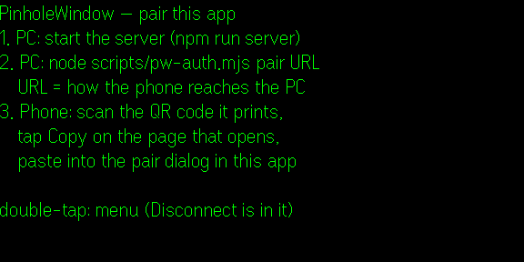

# はじめに

[English](getting-started.md) | 日本語

Linux マシンで、チェックアウトした直後の状態からグラスにミラーデスクトップを映すまでの
手順です。日常の操作は [usage.ja.md](usage.ja.md)、すべての設定項目は
[configuration.ja.md](configuration.ja.md) にあります。

## 必要なもの

| 項目 | 備考 |
| --- | --- |
| Linux | ネイティブ、または WSL2 + WSLg。対応しているバックエンドは Linux だけです。 |
| Node.js 22.18 以降 | サーバは TypeScript を `node` で直接実行します。 |
| システムパッケージ | 下記。 |
| Even Realities G2 と Even App | `app.json` は最小バージョンとして Even App 2.2.10、SDK 0.0.16 を宣言しています。 |
| TLS フロントエンド | スマホからサーバへ届くために必要です。この手順では `tailscale serve` を使います。 |
| 音声認識サービス | 任意。OpenAI の `POST /v1/audio/transcriptions` に応答するサーバなら何でも使えます。 |

```bash
sudo apt install -y xvfb ratpoison ffmpeg xdotool x11-utils xterm
```

`xserver-xephyr` は任意です。これがあり、PC にデスクトップがあれば、ミラーデスクトップは
PC のウィンドウにも表示されます。なければサーバは Xvfb を使い、デスクトップはアプリ越しに
だけ見えます。`scripts/sim.sh` は、`--headless` を付けない場合にこれを必要とします。

Linux バックエンドは、ミラーデスクトップをネストした X サーバ（ホストのディスプレイが
あれば Xephyr、なければ Xvfb）の上に用意し、ウィンドウを ratpoison で管理し、ffmpeg で
キャプチャし、xdotool で入力を注入します。[platform.md](platform.md) を参照してください。

## インストール

```bash
git clone <repository-url> pinhole-window
cd pinhole-window
npm ci
```

## サーバを起動する

```bash
npm run server          # node src/server/main.ts と同じ
```

サーバは次のように動きます。

- `127.0.0.1:8787` で待ち受ける（`PINHOLE_HOST`、`PINHOLE_PORT`）
- ディスプレイ `:100`（`PINHOLE_X11_DISPLAY`）でミラーデスクトップを起動し、暗い背景のターミナルを
  1 つ入れる（`PINHOLE_SPAWN`）
- 状態を `~/.pinhole-window` に置き、設定を `~/.pinhole-window/env` から読む

起動時のバナーは、認証が強制されているか、登録済みの端末数、env ファイルから取った設定、
セッション束縛（`PINHOLE_ORIGIN`）が強制されているかを表示します。設定を変えたら一度は
読んでください。

クライアントのページは別に配信します。開発中は Vite がポート 5273 で配信します。

```bash
npm run dev
```

`scripts/dev.sh` は両方を起動しますが、これは開発用のハーネスで、専用の端末レジストリ
（`.pw-x11/state`）を使い、`~/.pinhole-window/env` を読みません。開発にだけ使ってください。
[development.md](development.md) を参照してください。

## 端末をペアリングする

認証は既定で有効です。登録されていない端末は、どのルートからも `401` を受け取ります。
ペアリングは、端末が自分で生成した鍵ペアを登録する操作です。

ペアリングされるのはスマホ本体ではなく、アプリまたはブラウザです。鍵はそのアプリ自身の
保存領域に、サーバごとに 1 つずつ置かれます。同じスマホでも、Even App の版、開発版、
ブラウザはそれぞれ別にペアリングし、それぞれ登録枠（`PINHOLE_MAX_CLIENTS`）を 1 つ使います。

1. サーバを動かした状態で、端末がアプリを読み込む URL を渡してペアリング窓を開きます。

   ```bash
   node scripts/pw-auth.mjs pair 'https://host.ts.net:8443'
   ```

   ペアリング URL（アプリの URL に `?pair=<code>` を付けたもの）が表示され、ターミナルに出力している場合は QR
   コードも表示されます。窓は 2 分間開き、1 台だけを受け付けます。
2. その URL を端末で開きます。または、アプリを開いて **connection** を展開し、**pair** を
   タップして URL かコードを貼り付けます。
3. **Pair this app** をタップします。画面にパターン（randomart）と鍵の ID が表示されます。
4. ターミナルに、サーバが受け取ったパターンが表示されます。両方の画面のパターンが
   同じなら `y` と答えます。クライアントはリロードなしで接続します。

パッケージ版のアプリは URL を指定して開けません。その場合は、QR コードをスマホのカメラで
読み取り、開いたページで **Copy** をタップして、アプリのペアリング欄に貼り付けます。

未ペアリングのあいだは、グラスにも同じ手順が表示されます。



そのほかのコマンド:

| コマンド | 用途 |
| --- | --- |
| `pw-auth.mjs list` | 登録済みの端末 |
| `pw-auth.mjs pending` | 承認待ちの端末とそのパターン |
| `pw-auth.mjs approve <id>` / `reject <id>` | 承認待ちの端末を承認／拒否する（ID の先頭 4 文字で足ります） |
| `pw-auth.mjs rename <id> <名前>` | 端末に名前を付ける。登録時に付いた `client-…` の代わりに、`list` とスマホの登録済み鍵の表に表示されます |
| `pw-auth.mjs revoke <id>` | 端末を外す。その端末の次のリクエストから効きます |
| `pw-auth.mjs rotate` | 生きているセッションをすべて無効にする。登録は残ります |

既定では同時に登録できる端末は 1 台です（`PINHOLE_MAX_CLIENTS=1`）。端末をペアリングし直すと、
古い鍵が置き換わるのではなく新しい鍵が追加されるので、先に古い鍵を失効させます。

```bash
node scripts/pw-auth.mjs list
node scripts/pw-auth.mjs revoke <id>
node scripts/pw-auth.mjs pair 'https://host.ts.net:8443'
```

背景とセキュリティモデル: [security.md](security.md)。

## `tailscale serve` で実機のスマホから繋ぐ

サーバは TLS を終端せず、ループバックにバインドします。スマホから届くようにするには、
アプリと API を tailnet 内の 1 つの HTTPS オリジンにまとめて公開します。オリジンが
1 つなら CORS も mixed content も発生せず、API はループバックから出ません。

```bash
# API を /api の下に。ターゲット側も /api で終わること。
tailscale serve --bg --yes --https 8443 --set-path /api http://127.0.0.1:8787/api

# アプリをルートに。
tailscale serve --bg --yes --https 8443 http://127.0.0.1:5273
```

`tailscale serve status` は次のように表示します。

```
https://host.ts.net:8443 (tailnet only)
|-- /    proxy http://127.0.0.1:5273
|-- /api proxy http://127.0.0.1:8787/api
```

8443 の代わりに、空いている任意のポートを使えます。続いて:

1. `PINHOLE_ORIGIN` を端末がダイヤルする URL に設定し、サーバを再起動します。以後サーバは、
   ほかのオリジン宛てに作られたセッション署名を拒否します。

   ```bash
   install -d -m 700 ~/.pinhole-window
   install -m 600 /dev/null ~/.pinhole-window/env
   echo 'PINHOLE_ORIGIN=https://host.ts.net:8443' >> ~/.pinhole-window/env
   ```

2. Vite の開発サーバを使う場合は、ホットリロードのクライアントに戻り先を教えます。

   ```bash
   PINHOLE_HMR_HOST=host.ts.net PINHOLE_HMR_PORT=8443 npm run dev
   ```

   Vite は `*.ts.net` のホスト名を最初から受け付けます。ほかの名前（LAN のアドレスなど）は
   `PINHOLE_ALLOWED_HOSTS=name1,name2` で追加します。追加しないと Vite は
   `Blocked request. This host is not allowed.` と応答します。
3. `node scripts/pw-auth.mjs pair 'https://host.ts.net:8443'` でスマホをペアリングします。
   `?server=` パラメータは不要です。ループバック以外のオリジンから配信されたページは、
   自分のオリジンを API のベースとして使います。

tailnet 内の別の端末から結果を確認します。

| リクエスト | 期待される結果 |
| --- | --- |
| `GET /` | `200`、アプリのページ |
| `GET /api/health` | `401` — ゲートが効いている |
| `GET /api/auth/challenge` | `200` — ペアリングが使う公開ルート |

注意:

- `tailscale serve` を使い、`tailscale funnel` は使わないでください。funnel は
  インターネットに公開します。
- tailnet 内のすべての端末がこのポートに届きます。Tailscale が認証するのはネットワークで
  あってクライアントではないので、pinhole-window の認証は有効のままにしてください。
- 代わりにサーバを `0.0.0.0` にバインドしないでください。認証は通信路を暗号化しません。
  ループバック以外にバインドすると、サーバは起動のたびに警告します。
- プロキシの解除は `tailscale serve --https=8443 off`。

## Even App でアプリを読み込む

アプリは 1 枚の Web ページ（`index.html`。`app.json` が記述します）です。

- **開発サーバ。** Even App の開発者ハブでプロトタイプモードを選び、アプリの URL
  （上の `https://host.ts.net:8443`）の QR コードを読み取るか、URL 入力画面に進んで
  入力します。開発中のアプリを読み込む標準的な手順で、この手順書が説明しているのは
  この経路です。クライアントの変更はリロードで反映されます。開発中は読み込みを
  何度も繰り返しますが、ペアリングは端末ごとに一度だけの別の手順です
  （[端末をペアリングする](#端末をペアリングする)）。
- **パッケージ版。** `npm run build` は型検査のうえ静的なアプリを `dist/` に出力します。
  これを `app.json` と合わせて Even Hub のツールでパッケージにします。パッケージ版の
  アプリは独自のオリジンで動くので、サーバの場所を知りません。初回の起動時に尋ねます。
  未ペアリングの端末にはペアリングのダイアログが開き、ペアリング URL を貼り付けると
  サーバのアドレスも一緒に設定されます。すでに鍵を持っている端末には、サーバの URL
  だけを尋ねます。アドレスはあとから **connection** で変更できます。
  認証が有効なあいだサーバはすべてのオリジンを許可するので、CORS の設定は不要です。
  `PINHOLE_AUTH=0` の場合は、アプリのオリジンを `PINHOLE_ORIGINS` に指定する必要があります。

- **ストアから。** pinhole-window の公開後は、Even App で pinhole-window を探してインストールし、
  アプリ一覧から開きます。ほかのアプリと同じ手順です。これはパッケージ版なので、
  上の注意がそのまま当てはまります。

マイクの権限（`g2-microphone`、`phone-microphone`）と `network` は `app.json` で宣言しています。

## systemd のユーザサービスとして動かす

`systemd/pinhole-window@.service` はテンプレートユニットで、インスタンス名はチェックアウトの
絶対パスです。`systemd/env.example` はコメントつきの env ファイルです。

```bash
# リポジトリのルートで
mkdir -p ~/.config/systemd/user ~/.pinhole-window && chmod 700 ~/.pinhole-window
cp systemd/pinhole-window@.service ~/.config/systemd/user/
install -m 600 systemd/env.example ~/.pinhole-window/env
${EDITOR:-vi} ~/.pinhole-window/env          # 少なくとも PINHOLE_ORIGIN を設定する

unit="pinhole-window@$(systemd-escape --path "$PWD").service"
systemctl --user daemon-reload
systemctl --user enable --now "$unit"
systemctl --user status "$unit"
```

| 作業 | コマンド |
| --- | --- |
| ログを追う | `journalctl --user -u "$unit" -f` |
| 設定の変更や更新を反映する | `systemctl --user restart "$unit"` |
| 停止して自動起動を解除する | `systemctl --user disable --now "$unit"` |
| ログアウト後も動かし続ける | `sudo loginctl enable-linger "$USER"`（1 回だけ） |

- 再起動するとミラーデスクトップに再アタッチします。開いているウィンドウは残ります。
- ユーザユニットはログイン時の環境を引き継ぎません。それでもサーバはホストの
  ディスプレイを自分で見つけます。デスクトップがまだ無い時点から動かすには、env ファイルで
  `PINHOLE_HOST_DISPLAY=`（空）を設定し、ヘッドレスのバックエンドを優先させます。
- このユニットが提供するのは API だけです。クライアントのページは別に配信してください。

## 停止と片付け

サーバを止めても（`Ctrl-C`、またはユニットの停止）、ミラーデスクトップは止まりません。
再起動してもウィンドウが残るように、切り離して起動しているためです。消すには:

```bash
pgrep -af 'Xephyr :100|Xvfb :100'     # pid を調べる
kill <pid>                             # pid を指定する。pkill -f は使わない
rm -f .pw-x11/session.json             # セッションの記録を消す
```

Xephyr と Xvfb のバックエンドを切り替えたいときも同じ手順が必要です。生きている
セッションがあると、バックエンドを選ぶ前にそれへ再アタッチするためです。

そのほかを消すには、`tailscale serve --https=8443 off` を実行し、`~/.pinhole-window`
（登録済みの端末、割り当て、設定）とチェックアウト内の `.pw-x11/`（ランタイムファイルと
ログ）を削除します。

## 任意: 音声認識

音声入力には、OpenAI の `POST /v1/audio/transcriptions` に応答する認識サービスが必要です。
リポジトリには [speech.cpp](https://github.com/nyosegawa/speech.cpp) 用のユーザユニットが
入っていますが、互換のサーバなら何でも使えます。音声入力の仕組みは [voice.md](voice.md)
にあります。

1. `~/.local/bin/speech` ができるように speech.cpp をインストールし、シェルからモデルを
   取得します（モデルの置き場所を移している場合、サービス自身はダウンロードできません）。

   ```bash
   speech pull qwen3-asr-0.6b
   ```

2. ユニットをインストールして起動します。`127.0.0.1:8757` で待ち受けます。

   ```bash
   install -Dm644 systemd/speech-cpp.service ~/.config/systemd/user/speech-cpp.service
   systemctl --user daemon-reload
   systemctl --user enable --now speech-cpp.service
   curl -s http://127.0.0.1:8757/v1/models | grep -o '"id":"[^"]*"'
   ```

3. `~/.pinhole-window/env` で pinhole-window にその場所を教え、サーバを再起動します。

   ```
   PINHOLE_STT_URL=http://127.0.0.1:8757/v1/audio/transcriptions
   PINHOLE_STT_LANG=en
   ```

ユニットは `qwen3-asr-0.6b` を動かし、pinhole-window は既定でそのモデルの HTTP 上の ID
`Qwen3-ASR-0.6B` を送るので、`PINHOLE_STT_MODEL` は未設定のままで構いません。この 2 つは同じ
モデルを指す別の文字列です。片方を変えるならもう片方も変えてください
（[voice.md](voice.md#speechcpp)）。食い違うと、ルートが無いように見える `404` が返ります。

ユニットの設定は `~/.config/speech.cpp/service.env` で上書きし（たとえば
`SPEECH_MODEL_DIR=/path/to/models`）、
`systemctl --user restart speech-cpp.service` で反映します。認識サービスはループバックに
置いたままにしてください。認証を持たないサービスで、pinhole-window は自身の認証つき API を
通してこれを利用します。

背景: [speech service device and model placement](notes/2026-11-speech-service-setup.md)。
