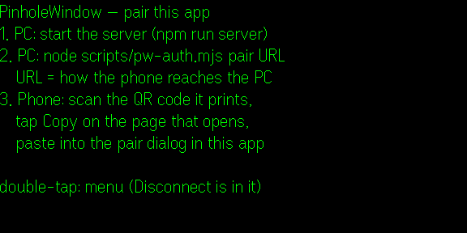

# Getting started

English | [日本語](getting-started.ja.md)

This guide takes a Linux machine from a fresh checkout to a mirrored desktop on the
glasses. Day-to-day operation is in [usage.md](usage.md); every setting is in
[configuration.md](configuration.md).

## Requirements

| Item | Notes |
| --- | --- |
| Linux | Native or WSL2 with WSLg. Linux is the only supported backend. |
| Node.js 22.18 or newer | The server runs TypeScript directly with `node`. |
| System packages | See below. |
| Even Realities G2 and the Even App | The app declares Even App 2.2.10 and SDK 0.0.16 as its minimum in `app.json`. |
| A TLS front end | Needed to reach the server from a phone. This guide uses `tailscale serve`. |
| Speech-to-text service | Optional. Any server that answers OpenAI's `POST /v1/audio/transcriptions`. |

```bash
sudo apt install -y xserver-xephyr xvfb ratpoison ffmpeg xdotool x11-utils xterm
```

The X11 backend hosts the mirrored desktop in a nested X server (Xephyr when a host
display exists, otherwise Xvfb), manages its windows with ratpoison, captures with
ffmpeg and injects input with xdotool. See [platform.md](platform.md).

## Install

```bash
git clone <repository-url> pinhole-window
cd pinhole-window
npm ci
```

## Start the server

```bash
npm run server          # same as: node src/server/main.ts
```

The server:

- listens on `127.0.0.1:8787` (`EW_HOST`, `EW_PORT`);
- starts the mirrored desktop on display `:100` (`EW_X11_DISPLAY`) with one dark
  terminal in it (`EW_SPAWN`);
- keeps its state in `~/.even-window` and reads settings from `~/.even-window/env`.

The start-up banner states whether authentication is enforced, how many devices are
enrolled, which settings came from the env file, and whether session binding
(`EW_ORIGIN`) is enforced. Read it once after every configuration change.

The client page is served separately. During development, Vite serves it on port 5273:

```bash
npm run dev
```

`scripts/dev.sh` starts both, but it is a development harness with its own device
registry (`.ew-x11/state`) and it does not read `~/.even-window/env`. Use it for
development only; see [development.md](development.md).

## Pair a device

Authentication is on by default: a device that is not enrolled gets `401` from every
route. Pairing enrols the key pair that the device generates for itself.

1. With the server running, open a pairing window, passing the URL the device will
   load the app from:

   ```bash
   node scripts/ew-auth.mjs pair 'https://host.ts.net:8443'
   ```

   It prints a pairing URL (the app URL plus `?pair=<code>`) and, on a terminal, a QR
   code. The window stays open for two minutes and admits one device.
2. Open that URL on the device, or open the app, expand **connection**, tap **pair**
   and paste the URL or the code.
3. Tap **Pair this device**. The device shows a pattern (randomart) and its id.
4. The terminal shows the pattern it received. If both screens show the same pattern,
   answer `y`. The client connects without a reload.

The packaged app cannot be opened at a URL. There, scan the QR code with the phone's
camera, tap **Copy** on the page that opens, and paste into the pair dialog of the app.

While the phone is not paired, the glasses show the same steps:



Other commands:

| Command | Purpose |
| --- | --- |
| `ew-auth.mjs list` | Enrolled devices |
| `ew-auth.mjs pending` | Devices waiting for approval, with their patterns |
| `ew-auth.mjs approve <id>` / `reject <id>` | Decide a pending device (first 4 characters of the id are enough) |
| `ew-auth.mjs revoke <id>` | Remove a device; takes effect on its next request |
| `ew-auth.mjs rotate` | Invalidate every live session; enrolments stay |

One device may be enrolled at a time by default (`EW_MAX_CLIENTS=1`). Pairing a
device again adds a new key instead of replacing the old one, so revoke the old key
first:

```bash
node scripts/ew-auth.mjs list
node scripts/ew-auth.mjs revoke <id>
node scripts/ew-auth.mjs pair 'https://host.ts.net:8443'
```

Background and the security model: [security.md](security.md).

## Connect a real phone through `tailscale serve`

The server terminates no TLS and binds to loopback. To reach it from a phone, publish
the app and the API under one HTTPS origin inside your tailnet. A single origin means
no CORS, no mixed content, and the API never leaves loopback.

```bash
# The API under /api. The target must end in /api as well.
tailscale serve --bg --yes --https 8443 --set-path /api http://127.0.0.1:8787/api

# The app at the root.
tailscale serve --bg --yes --https 8443 http://127.0.0.1:5273
```

`tailscale serve status` then shows:

```
https://host.ts.net:8443 (tailnet only)
|-- /    proxy http://127.0.0.1:5273
|-- /api proxy http://127.0.0.1:8787/api
```

Any free port works in place of 8443. Then:

1. Set `EW_ORIGIN` to the URL the device dials and restart the server. The server
   then refuses session signatures made out to any other origin.

   ```bash
   install -d -m 700 ~/.even-window
   install -m 600 /dev/null ~/.even-window/env
   echo 'EW_ORIGIN=https://host.ts.net:8443' >> ~/.even-window/env
   ```

2. If you use the Vite dev server, tell its hot-reload client where to dial back:

   ```bash
   EW_HMR_HOST=host.ts.net EW_HMR_PORT=8443 npm run dev
   ```

   Vite already accepts `*.ts.net` host names. Add other names (a LAN address, for
   example) with `EW_ALLOWED_HOSTS=name1,name2`; without it Vite answers
   `Blocked request. This host is not allowed.`
3. Pair the phone with `node scripts/ew-auth.mjs pair 'https://host.ts.net:8443'`.
   No `?server=` parameter is needed: a page served from a non-loopback origin uses
   its own origin as the API base.

Check the result from another tailnet device:

| Request | Expected |
| --- | --- |
| `GET /` | `200`, the app page |
| `GET /api/health` | `401` — the gate is up |
| `GET /api/auth/challenge` | `200` — the open route pairing uses |

Notes:

- Use `tailscale serve`, never `tailscale funnel`: funnel publishes to the internet.
- Every device in the tailnet can reach the port. Tailscale authenticates the
  network, not the client, so keep pinhole-window's authentication on.
- Do not bind the server to `0.0.0.0` instead. Authentication does not encrypt the
  channel, and the server warns on every start when bound off loopback.
- Remove the proxy with `tailscale serve --https=8443 off`.

## Load the app in the Even App

The app is one web page (`index.html`, described by `app.json`).

- **Dev server.** In the Even App, open the developer hub and choose prototype mode.
  Scan a QR code of the app URL (`https://host.ts.net:8443` above), or go on to the
  URL entry screen and type it. This is the standard way to load an app under
  development, and the path this guide documents; changes to the client are picked
  up on reload. Loading is repeated often during development; pairing is done once
  per device and is a separate step ([Pair a device](#pair-a-device)).
- **Packaged.** `npm run build` type-checks and writes the static app to `dist/`,
  which is packaged together with `app.json` using the Even Hub tooling. A packaged
  app runs on its own origin, so it cannot know where the server is. On first start it
  asks: a device that is not paired gets the pairing dialog, where a pasted pairing URL
  carries the server address, and a device that already holds a key is asked for the
  server URL only. The address can be changed later under **connection**.
  The server allows any origin while authentication is on, so no CORS setting is needed;
  with `EW_AUTH=0` the app's origin must be listed in `EW_ORIGINS`.

- **From the store.** Once pinhole-window is published, find it in the Even App,
  install it and open it from the app list, like any other app. That is the packaged
  build, so the notes above apply.

The microphone permissions (`g2-microphone`, `phone-microphone`) and `network` are declared in `app.json`.

## Run as a systemd user service

`systemd/even-window@.service` is a template unit whose instance name is the
absolute path of the checkout, and `systemd/env.example` is a commented env file.

```bash
# in the repository root
mkdir -p ~/.config/systemd/user ~/.even-window && chmod 700 ~/.even-window
cp systemd/even-window@.service ~/.config/systemd/user/
install -m 600 systemd/env.example ~/.even-window/env
${EDITOR:-vi} ~/.even-window/env          # set EW_ORIGIN at least

unit="even-window@$(systemd-escape --path "$PWD").service"
systemctl --user daemon-reload
systemctl --user enable --now "$unit"
systemctl --user status "$unit"
```

| Task | Command |
| --- | --- |
| Follow the log | `journalctl --user -u "$unit" -f` |
| Apply a configuration change or an update | `systemctl --user restart "$unit"` |
| Stop and disable | `systemctl --user disable --now "$unit"` |
| Keep running after logout | `sudo loginctl enable-linger "$USER"` (once) |

- A restart re-attaches to the mirrored desktop; open windows survive it.
- A user unit inherits no login environment. The server still finds a host display
  by itself. To run before any desktop exists, set `EW_HOST_DISPLAY=` (empty) in the
  env file so that the headless backend is preferred.
- The unit serves the API only. Serve the client page separately.

## Stop and clean up

Stopping the server (`Ctrl-C`, or stopping the unit) does not stop the mirrored
desktop. It is started detached so that a restart keeps your windows. To remove it:

```bash
pgrep -af 'Xephyr :100|Xvfb :100'     # find the pid
kill <pid>                             # by pid; do not use pkill -f
rm -f .ew-x11/session.json             # forget the session
```

Do this also when you want to switch between the Xephyr and Xvfb backends: a live
session is re-attached before any backend choice is made.

To remove everything else: `tailscale serve --https=8443 off`, and delete
`~/.even-window` (enrolled devices, bindings, settings) and `.ew-x11/` in the
checkout (runtime files and logs).

## Optional: speech-to-text

Voice input needs a recogniser that answers OpenAI's `POST /v1/audio/transcriptions`.
The repository ships a user unit for [speech.cpp](https://github.com/nyosegawa/speech.cpp);
any compatible server works. How voice input works is in [voice.md](voice.md).

1. Install speech.cpp so that `~/.local/bin/speech` exists, then fetch the model
   from a shell (the service cannot download into a relocated model directory):

   ```bash
   speech pull qwen3-asr-0.6b
   ```

2. Install and start the unit. It listens on `127.0.0.1:8757`.

   ```bash
   install -Dm644 systemd/speech-cpp.service ~/.config/systemd/user/speech-cpp.service
   systemctl --user daemon-reload
   systemctl --user enable --now speech-cpp.service
   curl -s http://127.0.0.1:8757/v1/models | grep -o '"id":"[^"]*"'
   ```

3. Point pinhole-window at it in `~/.even-window/env` and restart the server:

   ```
   EW_STT_URL=http://127.0.0.1:8757/v1/audio/transcriptions
   EW_STT_LANG=en
   ```

The unit serves `qwen3-asr-0.6b`, and pinhole-window sends that model's HTTP id,
`Qwen3-ASR-0.6B`, by default, so `EW_STT_MODEL` can stay unset. The two names are
different strings for the same model; if you change one, change the other
([voice.md](voice.md#speechcpp)). A mismatch returns a `404` that looks like a missing
route.

Override the unit's settings in `~/.config/speech.cpp/service.env` (for example
`SPEECH_MODEL_DIR=/path/to/models`), then
`systemctl --user restart speech-cpp.service`. Keep the recogniser on loopback: it
has no authentication, and pinhole-window reaches it through its own authenticated API.

Background: [speech service device and model placement](notes/2026-11-speech-service-setup.md).
