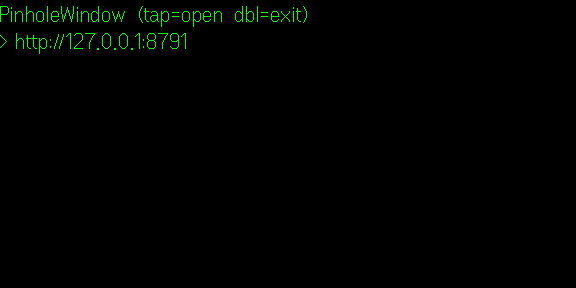
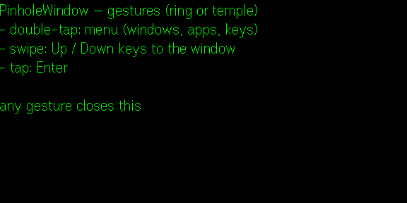
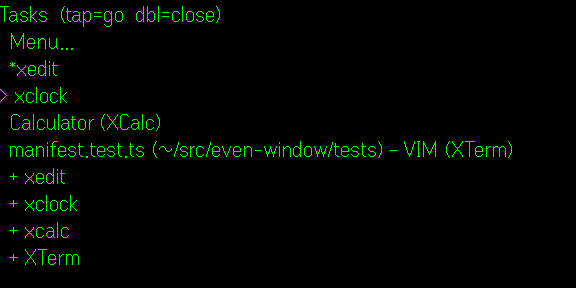
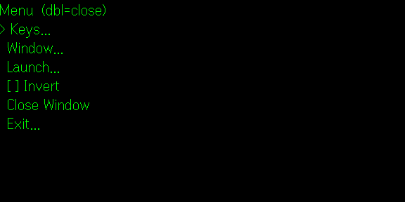
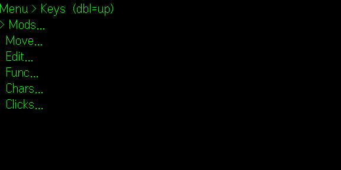
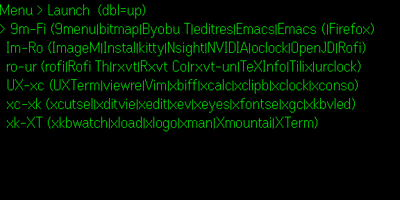

# Usage

English | [日本語](usage.ja.md)

How to use pinhole-window once it is running and a device is paired
([getting-started.md](getting-started.md)). The glasses show the mirrored desktop;
you operate it with gestures on the glasses and with the phone screen.

## The server list

The app starts at the list of servers it knows, on the glasses and on the phone. Nothing is
mirrored until you open one, even when there is only one. On the glasses, swipe to the server
and tap; on the phone, tap its row. The cursor starts on the server you used last. A list longer
than nine is shown on the glasses a page at a time: swipe past the last row to turn the page.

To add a server, type its URL under **connection** and tap **apply**, or tap **pair** and paste
a pairing URL. To come back to the list, choose `Disconnect` in the menu on the glasses, or tap
**disconnect** under **connection** on the phone. **…** beside a row offers **name**, which gives the server a name that the
glasses show in front of its address, and **forget**, which removes the server from this phone
and this phone's key from the server. Forget asks for a second tap. If the
server cannot be reached it asks again, since this phone's key would then stay enrolled there
until you revoke it on the PC.

A double tap at the list leaves the app, after the system's confirmation.

## Glasses gestures

Gestures come from either temple or from the ring.

| Gesture | At the server list | While mirroring | While the menu is open |
| --- | --- | --- | --- |
| Swipe up / down | Moves the cursor (wraps around) | Sends a key to the focused window: `Up` / `Down` by default, configurable per application | Moves the cursor (wraps around) |
| Tap | Opens the server | Sends `Return` | Selects the row |
| Double tap | Leaves the app | Opens the menu | Goes up one level; closes the menu at the top |
| Long press | — | Starts voice input, when a recogniser is configured | — |

Tap and then long press opens the system menu of the glasses (display off, brightness, close)
wherever you are.

Several swipes in quick succession are sent together as one batch, so a burst of
five swipes arrives as five key presses.

On the first few launches, the lens lists these gestures when the first server opens. The list
stays until you make a gesture: any gesture closes it, and a double tap also opens the menu.

## The on-glasses menu

Double tap to open it. While the menu is shown the mirror is hidden; it comes back
when the menu closes.

The first level, headed `Tasks`, lists, in this order:

- `Menu...`, which leads to everything else — the cursor is on it when the menu opens;
- the open windows, most recently focused first — tap one to switch to it. A short title
  is followed by the application, as in `~ (XTerm)`;
- rows starting with `+`: up to eight recently launched applications — tap one to
  launch it.

The panel shows a header and nine rows: `Menu...` and eight windows and `+` rows. With more
than eight windows and `+` rows together, the list is split into pages of eight, windows
first, and the header shows the page (`Tasks 1/2`). No `+` row is dropped for space. Every
other application is under `Menu...` → `Launch...`, and in the phone's **apps** palette.

With several pages, the first row reads `Menu/Prev/Next...`, and the level under it ends
with `Prev Page` and `Next Page`. They return to the list on the neighbouring page,
wrapping, with the cursor on the first row again: tap, swipe up, tap turns to the next page.

Under `Menu...`:

| Row | Purpose |
| --- | --- |
| `Keys...` | Send keys that a swipe cannot express: modifiers, movement and editing keys, function keys, characters, and mouse clicks and wheel steps |
| `Window...` | Window manager actions: next, previous and last window, new terminal, redisplay, key help, and `Kill (force)` |
| `Launch...` | Launch any application: the full list in name order. Up to nine are listed directly; more are split into pages, each row naming its range and the start of each name in it, such as `Fi-Gn (Files\|Firefox\|GIMP\|Gnome Te)` |
| `Invert` | Flip light and dark |
| `Close Window` | Ask the focused window to close |
| `Disconnect` | Go back to the server list |
| `Prev Page` / `Next Page` | Only with several pages, last: turn the first level's page |

| `Menu...` | `Keys...` | `Launch...` |
| --- | --- | --- |
|  |  |  |

A double tap goes up one level, and closes the menu from the first one. Only the
confirmation level (`Kill (force)...`) has a `< Back` row.

Choosing an action closes the menu so that you can see its result. After a row
under `Keys...`, the next double tap reopens the menu at the same place, which makes
repeated keys practical.

## The phone screen

The phone screen works without looking at the glasses, and most of it works without
the glasses connected. The first time it connects, a short tour walks through it; **?** in
the title row shows the tour again.

| Control | Purpose |
| --- | --- |
| **task** | Switch windows: every window, full titles, most recently focused first |
| **window** | The `Window...` actions and `Close Window`, without using the glasses. `Kill (force)` needs a second tap. |
| **apps** | Launch an application: the full list with a filter box, and **rescan** |
| Preview | A live copy of the mirror. Tap to click, drag to press and move (left button). While the glasses show the menu or the voice dialog, the preview shows that text instead. |
| Text box, **Submit** | Type text into the focused window. See below. |
| **voice** | Start voice input from the phone; shown only when a recogniser is configured |
| **▼ dn**, **▲ up**, **● tap**, **●● dbl** | The same four gestures as the glasses |
| **font −**, **font +** | Make text smaller or larger in the focused application |
| **keys** | An on-screen keyboard: modifiers, navigation keys and a QWERTY layout |
| **vRing** | A full-screen gesture pad: swipe vertically anywhere, tap the left half for tap, the right half for double tap. With voice input available, tap the band along the bottom edge for long press |
| **vPad** | A full-screen trackpad: drag to move, tap to click, hold to press and drag, two-finger drag or the right-edge strip for the wheel, a left / middle / right button selector, and Ctrl / Alt / Shift toggles that stay on until tapped again |
| **inv** | Flip light and dark |
| **color** / **green** | How the preview is drawn: the desktop's colours, or what the glasses show |
| **lens** | Pause and resume the glasses display |
| **app** | Per-application bindings |
| **connection** | Server URL, connection status, pairing, and the list of enrolled devices |
| **log** | The client log, with copy |

A hardware keyboard paired with the phone types into the focused window whenever no
text field on the page has focus.

A Bluetooth mouse or trackpad, including one built into a keyboard, works on an iPhone
through AssistiveTouch:

1. Pair the device in **Settings → Bluetooth**, or under **Settings → Accessibility →
   Touch → AssistiveTouch → Devices**.
2. Turn **AssistiveTouch** on in the same place. iOS then draws a pointer.
3. The pointer clicks like a finger on every control of this page. In **vPad**, moving it
   moves the desktop's pointer without pressing, and stops at the edge of the phone screen.

Pointer size and scrolling speed are under **Settings → Accessibility → Pointer Control**.
Apple documents both: [Use AssistiveTouch on iPhone](https://support.apple.com/guide/iphone/use-assistivetouch-iph96b21954/ios),
[pointer settings](https://support.apple.com/guide/iphone/adjust-pointer-settings-iphec6e1e60b/ios).

### Sending text

Type into the text box and tap **Submit**, or press `Ctrl+Enter` in the box. The text
is typed into the focused window, and then the application's **submit** key is
pressed. The default submit key is `off`: the text is typed and nothing is run. Set
it once for each application where you want Submit to run the line
([per-application bindings](#per-application-bindings)). The first few times Submit types
without a key, a toast points to this setting.

To send one text without the submit key, hold **Submit** until the button inverts,
then release. Slide off the button before releasing to cancel.

## Switching, closing and launching

| Task | On the glasses | On the phone |
| --- | --- | --- |
| Switch window | Double tap, pick a window | **task** |
| Close window | `Menu...` → `Close Window` | **window** → `Close Window` |
| Force-close | `Menu...` → `Window...` → `Kill (force)`, then confirm | **window** → `Kill (force)`, tap twice |
| Launch | Double tap, pick a `+` row; or `Menu...` → `Launch...` | **apps** |
| New terminal | `Menu...` → `Window...` → `New terminal` | **window** → `New terminal` |

Every window fills the whole screen; there is no tiling or resizing. To change what
the launcher lists, edit [`apps.conf`](configuration.md#appsconf).

## Per-application bindings

Open **app** on the phone. The folded heading shows the bindings in effect for the
focused window.

1. **app** — choose what the binding is attached to. The list offers every identity
   the focused window has, each labelled with its kind (binary, process name, window
   class, launcher entry). The preselected one follows the program wherever it is
   started from. Choose `*` to set the fallback for every application.
2. **▲ up**, **▼ dn** — the key each swipe sends: a key from the list plus `Ctrl`,
   `Alt`, `Shift` toggles, or `wheel up` / `wheel down`. A pager wants `Page_Up` /
   `Page_Down`, vim `Ctrl+u` / `Ctrl+d`, a web page the wheel.
3. **submit** — the key **Submit** presses after the text: `Enter` for a shell,
   `C-Enter` for many web forms, `Tab`, or `off`.
4. **newline** — what a line break inside the text becomes. Use `S-Enter` in chat
   fields where `Enter` would send.
5. **fontsize** — the keys **font −/+** press. The default suits xterm; other
   choices cover browsers and common terminals.
6. **apply**. **clear** removes the binding, and the application inherits again.

Swipes repeat: binding a swipe to `Return` makes five swipes run five commands, and
the panel warns when you do that. The bindings are stored in
[`bindings.json`](configuration.md#bindingsjson).

## Voice input

Available when the server has a recogniser configured
([set-up](getting-started.md#optional-speech-to-text)). Speech is recognised on your
PC and typed into the focused window.

1. Long press on the glasses, or tap **voice** on the phone.
2. Speak, then tap to stop (on the phone, **stop**). Recording also stops by itself
   after 30 seconds.
3. The glasses show the transcript with `Send`, `Again` and `Cancel`. Swipe to
   choose and tap to confirm. A double tap cancels at any stage. A transcript longer than
   six lines is shown in pages (the header says `1/3`): tap or swipe down to turn them.
   `Send`, `Again` and `Cancel` are on the last page only. Arriving there selects no row:
   one more tap or swipe down puts the cursor on `Send`, and a swipe up goes back.
   `Send` sends the whole transcript.
4. The transcript is also placed in the phone's text box, where you can edit it and
   tap **Submit** instead. `Cancel` clears the box. The dialog closes by itself after
   60 seconds without input.

`Send` behaves like **Submit**, including the application's submit key.

The glasses' microphone is used. If the app was started without the glasses
connected, the phone's microphone is used instead and the dialog appears on the
phone's preview only. How it works: [voice.md](voice.md).

## Pausing the mirror

Mirroring keeps the lenses lit and the radio link busy. To rest the glasses:

- **lens:on** — tap to pause. Updates stop, the lenses go dark, and the glasses show
  a short notice naming the control that resumes. The button reads **lens:off**; tap
  it to resume. The phone keeps working while paused. The pause is not remembered
  across restarts of the app.
- **In the case.** Putting the glasses in their case pauses the mirror, and taking
  them out resumes it. The button reads **lens:case**; tap it if the sensor is wrong,
  and the case sensor is ignored for the rest of the session.

Taking the glasses off does not pause the mirror: the wearing sensor proved
unreliable and is not used.

## Light and dark

The glasses are optical see-through and emissive: black is transparent, and bright
pixels glow. Dark backgrounds with light text read best and use the least power,
which is why the default terminal is dark.

**inv** on the phone, or `Invert` in the glasses menu, flips light and dark for
applications that only have a light theme. The setting is remembered on the device.
